# Browser Caption and Translation Architecture

This document describes the runtime boundaries for the browser viewer and the Node-only static content build. The deployed viewer remains static: there is no application server, bundler, or backend runtime.

## Runtime map

```mermaid
flowchart LR
  UI[web/app.js] --> Engine[LiveCaptionEngine]
  Engine --> Capture[AudioCaptureAdapter]
  Capture -->|tab audio or microphone| Provider{Speech provider}
  Provider -->|browser option| BrowserASR[BrowserSpeechRecognitionProvider]
  Provider -->|local option| LocalASR[LocalWhisperSpeechProvider]
  LocalASR --> Worklet[AudioWorkletPcmSource]
  Worklet --> PCM[live-audio-worklet.js]
  PCM --> Signal[audio-signal-processor.js]
  Signal --> Whisper[Transformers.js / ONNX Whisper]
  BrowserASR -->|final transcript| Queue[SerialTranslationQueue]
  Whisper -->|final transcript| Queue
  Queue --> Translate[app.js translation adapter]
  Translate --> Renderer[CaptionOverlayRenderer]
  Renderer --> UI
```



The application controller composes the modules and owns demo-page DOM, preferences, and toasts. The engine modules do not query application UI elements. Providers report events through callbacks; the engine owns session cancellation and ordered translation work. `web/streampl-player.js` is a separate, dependency-free web component for publisher sites; it wraps a native `<video>`, loads supplied subtitle tracks, and delegates on-demand subtitle localization to the shared `SubtitleEngine` API. It does not require the demo page's markup.

## Module responsibilities

| Module | Responsibility | Deliberately does not own |
| --- | --- | --- |
| `web/audio-signal-processor.js` | Pure PCM resampling and level conditioning; no DOM or model runtime | Capture permissions, inference, rendering |
| `web/live-audio-worklet.js` | Downmixes and batches PCM on the audio thread, then transfers buffers | Network, translation, app state |
| `web/local-whisper-provider.js` | On-demand runtime/model cache, AudioWorklet source, voice-activity windows, overlap filtering, Whisper invocation | Subtitle UI, translation-provider policy |
| `web/live-caption-engine.js` | Capture adapter, browser speech adapter, provider selection, state/session epochs, translation queue, glossary primitive, caption renderer | App markup, persistent UI settings |
| `web/app.js` | Shared subtitle parsing, translation policy, localization, persistence, demo UI composition | Audio processing internals |
| `web/streampl-player.js` | Framework-free embeddable player component, language menu, native-video integration, generated tracks | Media hosting, ASR, translation-provider implementation |
| `scripts/headless-translator.js` | CI/static-track build using shared parsing, formatting, term protection, and Node APIs | Browser runtime or deployed server |

The local Whisper module requires the pure signal module. The engine receives both as explicit dependencies and re-exports their public APIs for existing callers. In the demo browser app the globals are loaded in this order: audio signal processor, local Whisper provider, live caption engine, app, then the optional embed component. Publisher pages load `app.js` followed by `streampl-player.js`; `app.js` exports `window.SubtitleEngine` and safely skips demo initialization when `#video-player` is absent. In Node, CommonJS `require` resolves the audio module dependency chain.

## Data and event contracts

`LiveCaptionEngine.start()` accepts a small configuration object:

```js
{
  sourceLang, targetLang, audioSource,
  asrProvider, // "browser" or "local-whisper"
  modelId      // used only by local Whisper
}
```

A speech provider receives `{ sourceLang, stream, audioTrack, onState, onInterim, onFinal, onError }`. Providers may own their recognizer or audio graph, but they must:

- resolve `start()` only after they are ready to accept audio;
- emit final transcript objects with `text` and `sourceLang`;
- stop idempotently and ignore callbacks from obsolete sessions;
- report recoverable states such as loading, listening, transcribing, and no speech;
- report failures as structured `{ code, error }` objects where possible.

The engine stamps each start with a monotonically increasing session epoch. The serial translation queue has its own epoch. Stopping or restarting invalidates both, so a late model result or translation cannot repaint a newer session.

## Local audio and inference lifecycle

1. `AudioCaptureAdapter` requests shared-tab audio or a microphone stream. Tab capture is preferred for clean playback audio; microphone capture is an explicit alternative.
2. `AudioWorkletPcmSource` connects the stream to `live-audio-worklet.js`. The worklet averages channels into mono, batches roughly a quarter-second of PCM, and transfers the backing buffer instead of posting every render quantum.
3. `LocalWhisperSpeechProvider` tracks audio backlog and voice activity. It skips quiet-only windows, flushes a phrase after a pause once the minimum window is met, and caps the maximum inference window. If inference falls behind, the backlog is bounded rather than growing without limit.
4. `audio-signal-processor.js` resamples the window to the model's 16 kHz input and applies bounded DC removal/level conditioning. Whisper runs with timestamp output and a small beam-search setting; repeated text across overlapping windows is filtered before translation.
5. The runtime is imported only when local ASR is selected. A cached pipeline is reused within the page; Transformers.js browser caching handles model assets. WebGPU is attempted when available and initialization errors fall back to WASM.

The default model is Whisper Base. Tiny is available for lower-resource devices and Small for higher-resource devices. These are pretrained model weights, not a model trained by this repository. Model downloads, browser storage eviction, hardware acceleration, and real-time speed vary by browser and device; tests mock the inference boundary and do not claim to verify those external downloads.

## Translation and terminology boundary

All browser translation paths run text through `maskTranslationInput()` before calling a provider and restore it afterward. This preserves formatting tokens and known platform/product terms such as **YouTube Shorts**. User glossary terms take precedence in live captions and can supply one target string or per-language target mappings for subtitle jobs; the headless builder uses the same protection logic. Glossary content participates in cache keys and headless build invalidation, preventing stale preferred terms from being reused.

`RollingContextWindow` holds the last five live lines and register signals. Subtitle-file translation additionally supplies the next two source cues as lookahead; the OpenAI-compatible prompt uses both directions of context to resolve references, ellipsis, and punchlines while requesting output for only the current cue. It receives target-language-neutral localization instructions: preserve intent, subtext, voice, humor, register, and factual meaning; render idioms, slang, sarcasm, wordplay, and cultural references naturally instead of calquing them. DeepL receives bounded neighboring source cues through its context parameter. Google GTX and MyMemory receive the full current utterance and protected terms but do not expose the same conversation-context or style-instruction controls. Quality and idiom handling vary by provider and language pair; no automatic engine can guarantee a correct interpretation in every context. The selected translation provider may send transcript text to its service; local Whisper audio itself stays in the browser.

File-based subtitle translation remains the synchronization-first path. It copies cue identifiers/timestamps unchanged, then applies the existing TokenShield, formatter, Polish preposition binding, register handling, and hard 42-CPL validation. The translation cache key includes a rules version so older cached literal brand translations are not reused after terminology changes.

## Failure and privacy behavior

- Permission, capture, AudioWorklet, model download, inference, and translation errors stay distinct at the event boundary and are converted to localized UI messages by `app.js`.
- A failed WebGPU initialization falls back to WASM. A failed model download does not silently fall back to a cloud ASR provider.
- Microphone/tab streams, audio buffers, model instances, and caption cues are released or invalidated on Stop.
- The model runtime and weights download from their configured upstreams on first use. The app adds no backend; remote translation/browser speech services remain subject to their own privacy and availability policies.
- Persistent items are limited to user preferences, glossary text, and the existing subtitle cache. The live transcript context is held in memory for the active session.

## Validation and extension points

`node --test tests/app.test.js` covers pure signal conditioning, voice-activity windows, provider contracts, queue cancellation, term protection across browser/headless flows, localization, cue timestamps, and formatting invariants. The runtime/model network and device-specific WebGPU behavior require a real browser and are intentionally not claimed as verified by unit tests.

To add another speech backend, implement the provider callback contract and register it in `LiveCaptionEngine` without modifying the translation queue or renderer. To add a preferred product term, update the shared term list and its cross-path tests. To add a translation backend, implement `ClientTranslator.translateSegment()` while preserving the TokenShield placeholders and context contract.
